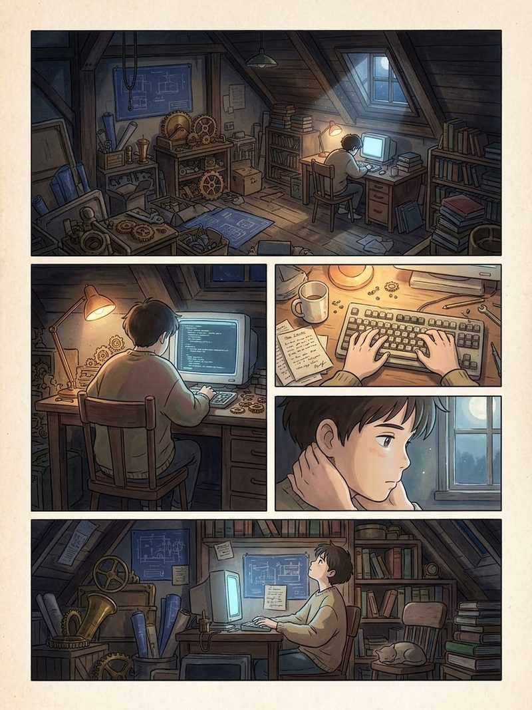
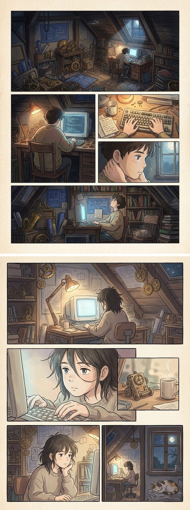

# ghibli-comic-skill

把一个主题变成**宫崎骏 / 吉卜力风**的单张封面或多格漫画，底层走 Gemini。

作为 Agent Skill 使用，也可以当普通脚本直接跑。

```
主题（文字或 Markdown）
  → LLM 规划分镜（可选）
  → Gemini 出图
  → 裁剪 / 拼接
  → 可选上传微信公众号素材库，取 thumb_media_id
```

---

## 效果

**单张封面**（`--aspect 2.35:1`，1800×766）——主题「独立开发者的一天」，自动匹配 `workshop` 预设：


**多格漫画页**（`--mode comic --layout mixed`，1200×1600，Gemini 自动分镜）——主题「深夜写代码的孤独」：



**竖向长图**（`--stitch`，多页拼成一张，适合公众号正文内插）：



---

## 为什么做这个

想把一篇文章变成配图时，常见的两种别扭：

- **纯 AI 味**：直接让模型出图，没规划，画出来是四张不搭的插画。
- **纯风格模板**：套固定风格提示词，所有文章长得一样。

这个 skill 的思路是：**先让 LLM 把主题拆成分镜，再让画图模型逐页执行**，
并且用第一页当后续页的风格参考锁住一致性。

## 特点

- **两种模式**：单张封面（公众号首条大图 2.35:1）/ 多格漫画（可拼成长图）
- **画风一致**：首图作 reference + LLM 写的 `character_note`，跨页角色不跑偏
- **8 种场景预设**：按关键词自动选背景，不用每次手写风格
- **5 种分格布局**：四格 / 传统 / 电影横向 / 满版 / 混排
- **分镜表落盘**：`storyboard.json` + 每页 prompt 单独存，换后端不用重新规划
- **微信直连**：`--upload` 一步取到封面用的 `thumb_media_id`
- **两种后端**：Gemini Web 逆向 API（走会员额度）或 Google AI Studio API Key

## 安装

### 方式一：作为 Agent Skill

```bash
git clone https://github.com/zackzhangkai/ghibli-comic-skill.git \
  ~/.workbuddy/skills/ghibli-comic
```

Claude Code / Codex 同理，放到各自的 skills 目录。

### 方式二：直接当脚本用

```bash
git clone https://github.com/zackzhangkai/ghibli-comic-skill.git
cd ghibli-comic-skill
pip install pillow
```

## 依赖

| 依赖 | 用途 |
|---|---|
| Python 3.10+ | — |
| `pillow` | 裁剪、拼接、格式转换 |
| `bun` 或 `npx` | 只有用 `gemini-web` 后端才需要 |
| Gemini 登录态 | 同上，走浏览器 cookie |
| `GEMINI_API_KEY` | 只有用 `google-api` 后端才需要 |

`gemini-web` 后端还依赖 `baoyu-danger-gemini-web` skill 提供 CLI 封装。

## 用法

### 单张封面

```bash
python scripts/ghibli_comic.py --topic "AI 编程工具横评"
# → cover-ai-<时间戳>.jpg  1800×766
```

### 多格漫画 + 长图

```bash
python scripts/ghibli_comic.py \
  --topic "一个人做产品的第100天" \
  --mode comic --pages 4 --layout mixed --stitch \
  --outdir ./ghibli-day100
```

产物：

```
ghibli-day100/
├── storyboard.json                 # 分镜表
├── 00-ghibli-day100-long.jpg       # 竖向长图（--stitch）
└── pages/
    ├── 01-prompt.md                # 每页完整 prompt
    ├── 01-ghibli-day100.jpg
    └── ...
```

### 从文章抽主题

```bash
python scripts/ghibli_comic.py --article ./post.md --mode comic --pages 6
```

脚本会抽 H1、H2/H3 和正文前 4000 字的高频词当 motifs 塞进 prompt。

### 上传微信素材

```bash
python scripts/ghibli_comic.py --topic "..." --upload --meta cover.json
```

凭证从 `~/.wechat-mp.json` 读（appid / secret），返回：

```json
{
  "cover": "./cover-....jpg",
  "thumb_media_id": "xxxxxxxx",
  "url": "http://mmbiz.qpic.cn/..."
}
```

### 先看 prompt 不花钱

```bash
python scripts/ghibli_comic.py --topic "..." --mode comic --pages 4 --dry-run
```

## 参数

| 参数 | 说明 | 默认 |
|---|---|---|
| `--article <md>` | 从 Markdown 抽主题 | — |
| `--topic <text>` | 直接指定主题 | — |
| `--title <text>` | 只有标题时用 | — |
| `--input-image <path>` | 跳过生成，只后处理/上传 | — |
| `--mode` | `auto` / `cover` / `comic` | `auto` |
| `--pages <n>` | 漫画页数 | `4` |
| `--layout` | `four-panel`/`standard`/`cinematic`/`splash`/`mixed` | `mixed` |
| `--stitch` | 多页竖向拼成长图 | 关 |
| `--aspect` | `2.35:1`/`16:9`/`1:1`/`4:3`/`3:4` | cover `2.35:1`，comic `3:4` |
| `--preset` | 场景预设 | `auto` |
| `--backend` | `auto`/`gemini-web`/`google-api` | `auto` |
| `--model` | 画图模型 | `gemini-3.0-pro` |
| `--text-model` | 分镜规划模型 | `gemini-3.0-flash` |
| `--out <path>` | 单图输出路径 | 自动 |
| `--outdir <path>` | 漫画输出目录 | 自动 |
| `--upload` | 上传微信素材 | 关 |
| `--meta <json>` | 结果写 JSON | — |
| `--keep-raw` | 保留原始输出 | 关 |
| `--dry-run` | 只打印 prompt | 关 |

## 场景预设

| preset | 画面 | 自动触发词 |
|---|---|---|
| `countryside` | 夏日乡野、稻田、远山 | 乡/村/成长/童年/故乡 |
| `sky` | 积云、俯瞰 | 云/飞行/远眺/格局 |
| `town` | 黄昏老街、暖光店铺 | 城市/街/夜市/烟火 |
| `sea` | 海边悬崖、白护栏 | 海/浪/岛/旅行 |
| `forest` | 苔藓巨木、光斑 | 森林/树/生态/自然 |
| `workshop` | 深夜工作室、图纸、台灯 | 代码/AI/agent/开发/开源 |
| `station` | 清晨乡站、长椅、蒸汽 | 等待/告别/旅途 |
| `library` | 环形书架、穹顶光尘 | 书/知识/文档/学习 |

匹配不上落 `countryside`。`--preset` 可强制。

## 输出尺寸

| aspect | 尺寸 | 用途 |
|---|---|---|
| `2.35:1` | 1800×766 | 公众号首条大图 |
| `16:9` | 1920×1080 | 通用宽图 |
| `1:1` | 800×800 | 次条 / 头像 |
| `4:3` | 1600×1200 | 横版配图 |
| `3:4` | 1200×1600 | 漫画页默认 |

## 后端

### gemini-web（默认）

走 Gemini 网页版逆向 API，**消耗你的 Gemini 会员额度**，不需要付费 API Key。

首次使用需要同意书：
`~/Library/Application Support/baoyu-skills/gemini-web/consent.json`

```json
{ "accepted": true, "disclaimerVersion": "1.0" }
```

登录态过期时：

```bash
cd <baoyu-danger-gemini-web 目录>
npx -y bun scripts/main.ts --login
```

会弹 Chrome，手动登录一次 Gemini 即可。

### google-api

```bash
export GEMINI_API_KEY=...
python scripts/ghibli_comic.py --topic "..." --backend google-api
```

## 已知限制

**这些是真的坑，不是配置问题：**

- **Gemini 不认 2.35:1**。脚本先生成 21:9 再裁。别直接让它出 2.35:1。
- **零文字**。所有 prompt 硬编码 `no text` / `no watermark` / `no speech bubbles`。
  吉卜力风 + 文字 = 大概率乱码。要带中文标题的封面请换 ImageGen（混元）那条路。
- **cookie 会过期**。逆向 API 固有问题，报
  `SECURE_1PSIDTS could get expired frequently` 就重新 `--login`。
- **角色一致性不是 100%**。首图 reference + `character_note` 能锁得比较稳，
  但翻页后细微差异仍会出现。这是当前模型能力上限。
- **多页漫画吃额度**。`--pages 4` = 4 次出图 + 1 次分镜规划。先 `--dry-run`。
- **漫画模式会覆写 `--aspect`**。传了 `2.35:1` 也被改成 `3:4`，因为竖版更适合漫画页。

## 对比

| | 这个 | 内置 ImageGen |
|---|---|---|
| 模型 | Gemini 3.0 Pro | 混元 hunyuan-image-v3.0 |
| 宽高比 | ✅ 21:9 → 2.35:1 | ❌ 恒 1:1 |
| 图上文字 | ❌ 强制无文字 | ✅ 中文渲染准确 |
| 多页漫画 | ✅ 分镜 + 拼接 | ❌ |
| 微信对接 | ✅ 一条龙 | ❌ |

选型建议：**要吉卜力插画风 / 多页漫画 / 直推微信 → 用这个；要图上带中文标题 → 用 ImageGen**。

## 许可证

MIT